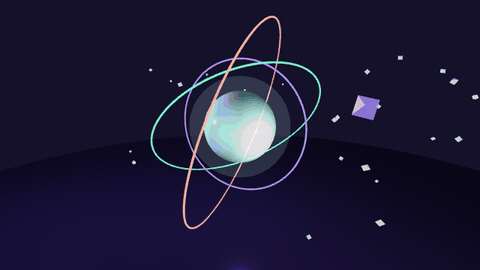
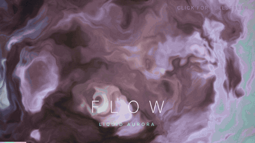
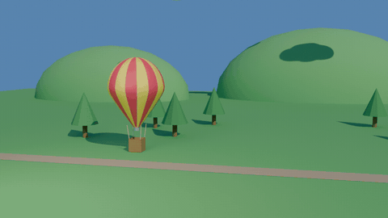

# Computer Graphics Portfolio

Real-time graphics experiments built with **Three.js** and **raw WebGL shaders**, plus a fully procedural 3D scene generated with **Blender's Python API**.

**Live gallery:** https://yashishah176.github.io/computer-graphics/

| Project | Preview | Tech |
|---|---|---|
| **[Dreamy Orb](dreamy-orb/)** · [Live demo](https://yashishah176.github.io/computer-graphics/dreamy-orb/) |  | Three.js, PBR materials, lights, fog |
| **[Lumina](lumina/)** · [Live demo](https://yashishah176.github.io/computer-graphics/lumina/) |  | WebGL, GLSL, raymarching, FBM noise |
| **[Hot-Air Balloon Lift-Off](hot-air-balloon-blender/)** · [Video](hot-air-balloon-blender/animation.mp4) |  | Blender, bpy/bmesh, keyframes, Cycles |

## Projects

### Dreamy Orb
A glowing glass orb that breathes and shifts through a lavender–mint–peach–rose palette. Three gyroscope rings spin and pulse around it, 30 crystal shards drift in a wave, and a camera slowly orbits and zooms over a glossy floor.

**Techniques:** `MeshPhysicalMaterial` with clearcoat, additive back-face glow shell, point lights that follow the orb, exponential fog, palette interpolation over time.

### Lumina
A 30-second looping shader film in three acts, all drawn by a single fragment shader on one full-screen triangle:
1. **Flow** – liquid aurora from domain-warped fractal Brownian motion noise
2. **Orbit** – raymarched iridescent orb with a ring and satellites, Fresnel shading and specular highlights
3. **Portal** – kaleidoscope neon tunnel built in polar coordinates

Scenes cross-fade, captions fade in and out, and the camera reacts to the mouse. Click for fullscreen.

### Hot-Air Balloon Lift-Off (Blender)
A 150-frame animation of a striped balloon lifting off over a countryside valley. The whole scene is built by [`balloon_scene.py`](hot-air-balloon-blender/balloon_scene.py):
- **Polygonal modelling** with `bmesh`: teardrop envelope from a reshaped UV sphere, basket hollowed by inset + extrude
- **Materials:** Principled BSDF, red/yellow gores assigned per face, emissive flickering burner flame
- **Lighting & camera:** sun + area light, camera with a Track To constraint
- **Animation:** keyframed lift-off, drift and sway; rendered in Cycles

To rebuild it: open Blender → **Scripting** tab → open `balloon_scene.py` → **Run Script**. Or just open `HotAirBalloon.blend`.

## Run locally
The web projects are single HTML files with no build step. Open `dreamy-orb/index.html` or `lumina/index.html` in a modern browser.

---
Made by **Yashi Shah**
